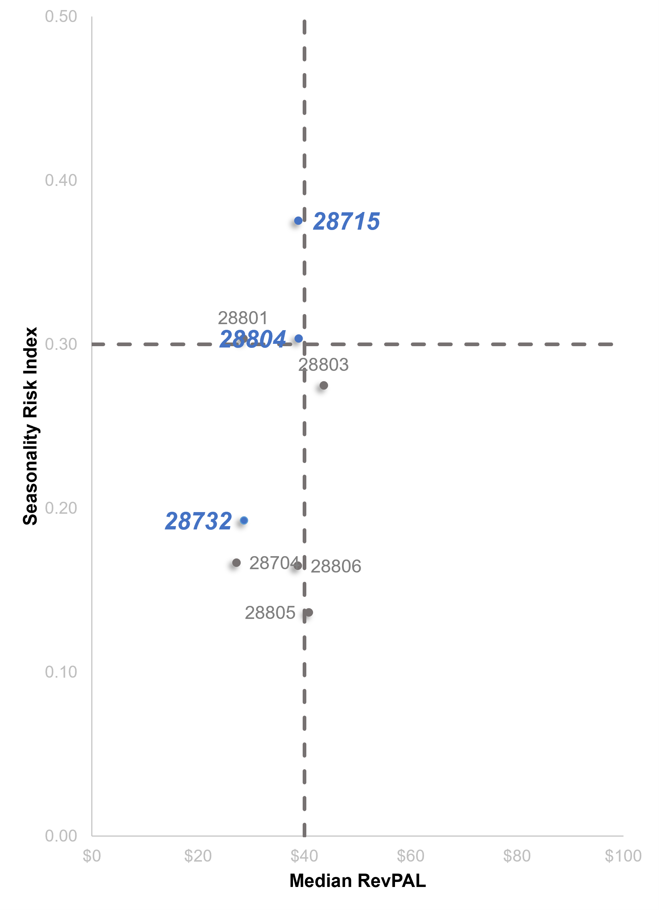
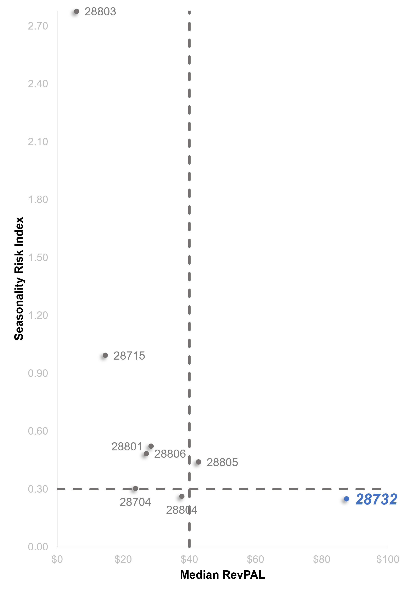
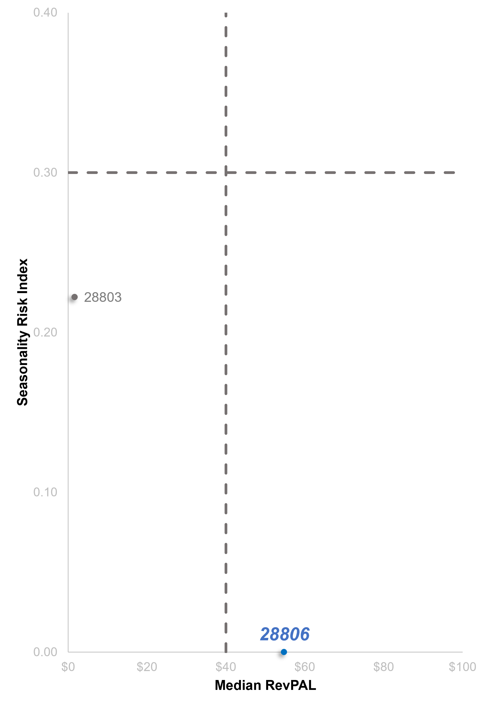
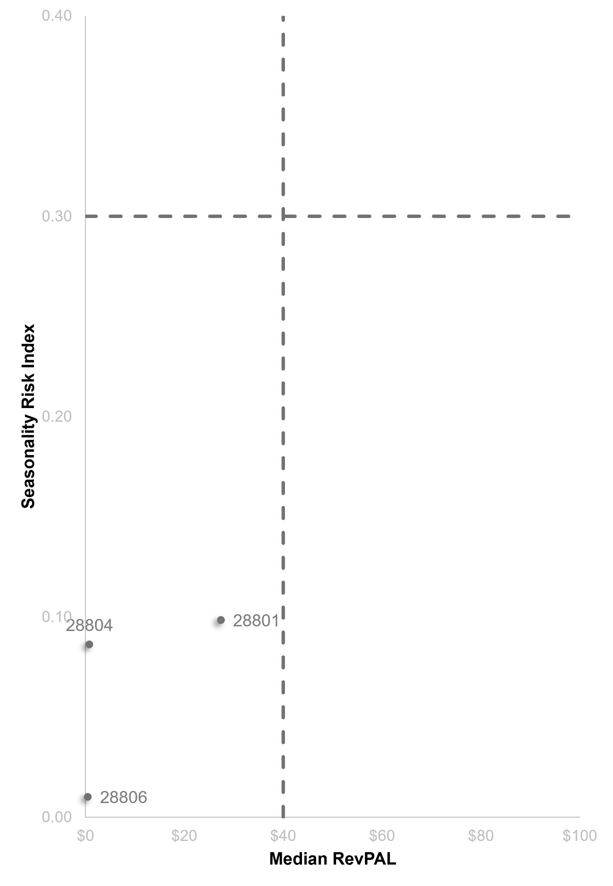

  

<h1 align="center" style="font-size: 56px;">
  Asheville Market Expansion Analysis
</h1>

<h2 align="center" style="font-size: 40px;">
  Background &amp; Overview
</h2>

Founded in 2007, Airbnb began when two hosts welcomed three guests into their San Francisco home. Since then, it has grown into a global platform with more than 5.5 million hosts and over 2.5 billion guest arrivals worldwide. Through unique accommodations, experiences, and services, Airbnb enables travelers to connect more authentically with local communities, including Asheville, North Carolina.

Reporting to management, this project evaluates pricing, demand, and host activity trends in Asheville from 2011 to 2025 to help a travel startup assess the feasibility of market expansion. The analysis identifies promising neighborhoods and property types while evaluating potential risks, such as seasonal demand fluctuations, market competition, and reliance on a small number of hosts. Insights and recommendations are provided on the following key areas:

#### **North Star Metrics**
  - **Revenue Viability Analysis:** Analyzing Airbnb's Room Type and Neighborhood to assess Median RevPAL and Seasonality Risk
  - **Review & Demand Analysis:** Evaluation of historical booking patterns, focusing on Demand Growth Rate and Supply Growth Rate
  - **Host Analysis:** An assessment of the Top Host Share by Revenue and Median Occupancy Rate

<h2 align="center" style="font-size: 40px;">
  Executive Summary
</h2>

  <strong>Chart Title</strong>

  

<h2 align="center" style="font-size: 40px;">
  Data Structure Overview
</h2>

Airbnb's database structure as seen below consists of three tables: details about each listing, neighborhood codes for listings and historical review activity by listing, with a total row count of 321, 433 records.

  

*The Excel utilized to organize, prepare and visualize data for the ad hoc report can be found [here](https://github.com/joshuabufi-analyst/Asheville-Airbnb-Listings-Analysis/blob/main/Dashboard/Project%201.xlsb).*

<h2 align="center" style="font-size: 40px;">
  Insights Deep Dive
</h2>

### Caveats & Assumptions
  This analysis applies several assumptions and methodological adjustments to address limitations in the available data. These measures provide a consistent basis for calculating and comparing key performance metrics, while the stated caveats highlight where results may differ from actual or independently verified business outcomes. Therefore, the findings should be interpreted in light of the assumptions and limitations outlined in the analysis.

**Scope of Rental Duration:** The analysis focuses on short-term rentals, defined for this project as stays lasting a few days to fewer than 30 consecutive nights. This scope reflects the conventional short-stay accommodation market, where bookings generate platform service-fee revenue for Airbnb through its website and app. Longer stays were excluded to maintain a consistent focus on short-term accommodation patterns. This cutoff is an analytical assumption rather than a restriction on Airbnb's business model, which also accommodates longer-term stays.

**Missing Price Treatment:** Listings with missing or invalid prices were excluded from the Median RevPAR calculation because a valid price is required to calculate this metric. Price imputation using the median of a specific room type and neighborhood was avoided because listing prices may vary considerably based on property size, location, condition, amenities, and other characteristics that cannot be fully captured by these groupings. These listings remained included in other KPI calculations where the required data fields were available and valid.

**Active Listing Definition:** Listing activity was assessed using two criteria: at least one review in the last 12 months and a reviews-per-month value greater than zero. `availability_365` was analyzed separately because the dataset defines it as the number of days a listing is available for booking within the next 365 days. Unavailable dates may reflect guest bookings or host-blocked calendars; therefore, availability alone cannot reliably establish listing activity or demand. This approach avoids imposing an arbitrary availability threshold and reduces the risk of misclassifying active listings.

**Recent Market Activity Filter:** The market expansion analysis includes listings whose last review date falls between June 16, 2024, and June 16, 2025. This 12-month window serves as a proxy for recent guest activity, helping focus the analysis on listings with evidence of recent market participation. 

### Revenue Viability Analysis:
The market's overall median RevPAL (Revenue per Available Listing) is $35.84, below the assigned threshold of $40 per night, indicating that the typical listing generates less revenue per available night than the target benchmark. Meanwhile, the Seasonality Risk Index of 0.15 is below the 0.30 threshold, suggesting relatively low seasonal risk under the established methodology. Together, these findings indicate that **the market has below-target revenue potential but relatively low seasonality risk**. Although revenue performance may be consistently below the target, further analysis is needed to determine whether the market offers sufficient profitability and long-term expansion potential.

<table>
  <tr>
    <td width="40%" align="center">
      

      <strong>Homes/apartments in neighborhoods 28803 and 28805 have the most stable revenue potential.</strong>
      

      
    </td>
    <td width="60%" valign="top">

  - **Promising opportunity** — Home/Apartment properties in neighborhoods 28803 and 28805 show low seasonality risk (0.28 and 0.14) and median RevPAL values of $43.60 and $40.80 per night, respectively, both exceeding the $40 threshold and indicating stable revenue potential.
  - **High risk, below-target revenue** — Neighborhoods 28804, 28801, and 28715 have high seasonality risk and median RevPAL below the target. Neighborhood 28715 has the highest risk (0.38), while 28801 and 28804 are at the 0.30 threshold. Hosts should improve listing photos and guest reviews, adjust rates to match seasonal demand, maintain competitive off-season pricing, and reserve peak-season profits to cover off-season expenses and potential cash shortfalls.
  - **Low risk, below-target revenue** — Neighborhoods 28732, 28704, and 28806 have low seasonality risk but median RevPAL below $40 per night. Neighborhood 28806 is closest to the target at $38.70. Hosts should assess ADR and occupancy to identify performance gaps, adjust off-peak rates or minimum-stay requirements to boost bookings, raise rates during strong demand, and improve listing photos and guest reviews to increase appeal.
    </td>
  </tr>
</table>

<table>
  <tr>
    <td width="60%" valign="top">

- **Promising opportunity** — Neighborhood 28732: Private rooms have a Seasonality Risk Index of 0.25 and the highest median RevPAL at $87.52 per night, indicating relatively stable demand and strong revenue potential.

- **High risk, below-target revenue** — Neighborhoods 28806, 28801, 28715, and 28803: Neighborhood 28803 has the highest risk index at 2.78. Hosts should improve listing photos and reviews, adjust pricing to seasonal demand, offer competitive off-season rates, and save peak-season earnings for slower periods.

- **Low risk, below-target revenue** — Neighborhoods 28704 and 28804: Neighborhood 28804 comes closest to the target at $37.72 per night. Hosts should assess ADR and occupancy, optimize off-season pricing and minimum stays, adjust rates during peak demand, and improve listing appeal to increase bookings.

- **High risk, above-target revenue** Neighborhood 28805: Median RevPAL exceeds the $40 target at $42.74 per night, but the Seasonality Risk Index is 0.44. Hosts should adjust seasonal pricing, offer competitive off-season rates, and save peak-season earnings for slower periods.
    </td>

    <td width="40%" align="center">
      

      <strong>Private Rooms in neighborhood 28732 have the most stable revenue potential.</strong>
      

      
    </td>
  </tr>
</table>

<table width="100%">
  <tr>
    <td width="50%" align="center" valign="center">
      

        <strong>Hotel room properties in neighborhood 28806 have high revenue potential but require sufficient data to assess seasonal demand reliably.</strong>
      

      
    </td>
    <td width="50%" align="center" valign="center">
      

        <strong>All neighborhoods with Shared Room properties exhibit low seasonality risk but below-target revenue.</strong>
      

      
    </td>
  </tr>
</table>

  - Hotel Rooms in neighborhood 28806 have a median RevPAL of $54.74 per night, exceeding the $40 target. However, the Seasonality Risk Index (SRI) of 0 is inconclusive because it is based on only one September 2024 review, providing insufficient data to assess seasonal demand reliably. Because the coefficient of variation is sensitive to the number of observations, the zero index may reflect insufficient data rather than genuinely stable demand. Additional data are needed before determining the segment’s seasonality risk.

  - In contrast, Hotel Rooms in neighborhood 28803 have a low SRI of 0.22, below the 0.30 threshold, but a median RevPAL of only $1.58 per night. Hosts should investigate pricing, occupancy, and booking availability to identify revenue improvement opportunities before considering expansion.

  - Shared Rooms in neighborhoods 28801, 28804, and 28806 have SRI values below the 0.30 threshold but exhibit below-target revenue potential. Neighborhood 28801 has the highest median RevPAL among the three at $27.37 per night, still falling $12.63 below the $40 target. Hosts should assess ADR and occupancy to identify the causes of low revenue, optimize off-season pricing and minimum-stay requirements, adjust rates during peak-demand periods, and improve listing appeal to attract more bookings and increase revenue.

### Review & Demand Analysis:
### Host Analysis:

<h2 align="center" style="font-size: 40px;">
  Recommendations
</h2>

Based on the uncovered insights, here are actionable items that Airbnb can take away from our analysis.
